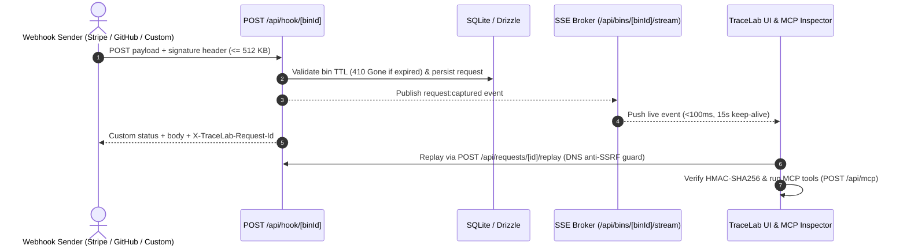

# TraceLab Webhooks

[](.github/workflows/ci.yml)

**Live SSE Webhook Inspector, Stripe/GitHub HMAC-SHA256 Verifier, Side-by-Side Replay Diff & Integrated MCP Server.**  
Inspect incoming webhooks in `<100ms` via Server-Sent Events, verify signatures in constant time, replay requests safely with DNS-resolved anti-SSRF protection, and query captured traffic directly from AI agents over JSON-RPC 2.0 MCP.

Live interactive sandbox: [`/demo`](http://localhost:3008/demo) · OpenAPI 3.1 Docs: [`/api/docs`](http://localhost:3008/api/docs)

---

## Architecture & Request Flow



---

## Architecture Decision Records (ADRs)

1. **In-Memory SSE Broker + SQLite WAL (`node:sqlite`)** — Single-process pub/sub delivers sub-100ms live updates without Redis overhead while WAL mode prevents read/write contention on local inspection workloads.
2. **DNS-Resolved Anti-SSRF Guard on Replay (`src/lib/ssrf.ts`)** — Every replay URL is parsed, restricted to `http:`/`https:`, and resolved via `dns.lookup(..., { all: true })` to reject loopback, private CIDRs, IPv6 ULA/link-local, and cloud metadata IPs before `fetch()`.
3. **Shared MCP Core (`src/mcp/tools.ts`) for HTTP + Stdio** — Both `POST /api/mcp` and `src/mcp/server.ts` dispatch through one JSON-RPC 2.0 handler exposing `list_recent_webhooks`, `get_webhook_detail`, `get_last_error_webhook`, and `verify_webhook_hmac`.

---

## Quick Start (3 Steps)

```bash
# 1. Install dependencies & initialize SQLite schema + demo-bin seed
pnpm install && pnpm db:migrate && pnpm db:seed

# 2. Run quality gates (lint, typecheck, unit tests)
pnpm lint && pnpm typecheck && pnpm test

# 3. Start TraceLab on http://localhost:3008
pnpm dev
```

---

## Honest 100 → 100k Scale Trade-Offs

1. **SSE Fan-Out**: The in-memory `EventEmitter` broker scales cleanly for 100 concurrent bins on one instance; at 100k concurrent listeners across multiple replicas, replace `src/core/sse-broker.ts` with Redis Pub/Sub or NATS.
2. **SQLite Storage**: `node:sqlite` + WAL handles thousands of local webhook captures with zero setup; at 100k+ requests/day or multi-writer deployments, switch Drizzle to the included PostgreSQL (`docker-compose.yml` + `src/db/schema.pg.ts`) target with TTL partitioning.
3. **Synchronous Replay**: `POST /api/requests/[id]/replay` awaits upstream HTTP responses (8s timeout) inline; at 100k replays, offload replay execution to a background job queue with exponential backoff.
