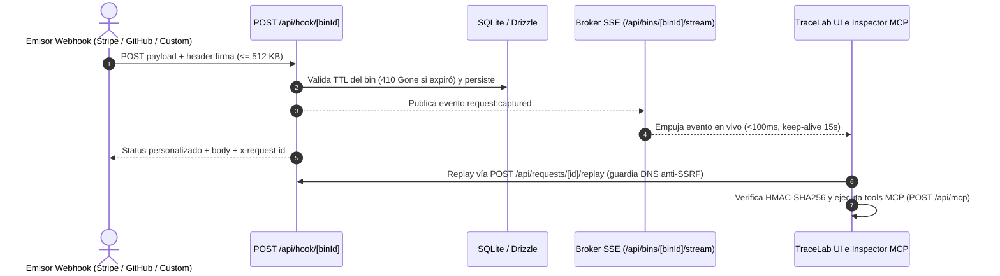

# TraceLab Webhooks

[](.github/workflows/ci.yml)

**Inspector de Webhooks en vivo por SSE, Verificador HMAC-SHA256 (Stripe y GitHub), Replay con Diff lado a lado y Servidor MCP integrado.**  
Captura peticiones entrantes en `<100 ms` mediante Server-Sent Events, verifica firmas en tiempo constante, reenvía webhooks de forma segura con protección anti-SSRF por DNS y consulta el tráfico capturado desde agentes de IA vía JSON-RPC 2.0 MCP.

## Qué hace este proyecto

**TraceLab Webhooks** crea URLs temporales (bins) para recibir, inspeccionar y depurar webhooks en tiempo real conforme llegan. Permite revisar headers y payload JSON al instante, validar firmas criptográficas HMAC de Stripe o GitHub, reenviar (*replay*) peticiones hacia tu servidor local comparando respuestas con un diff y consultar el historial desde asistentes de IA vía MCP.

Sandbox interactivo: [`/demo`](http://localhost:3008/demo) · Documentación OpenAPI 3.1: [`/api/docs`](http://localhost:3008/api/docs)

---

## Arquitectura y Flujo de Peticiones



---

## Decisiones Técnicas Clave (ADRs)

1. **Broker SSE en memoria + SQLite WAL (`node:sqlite`)**: Pub/sub en un solo proceso entrega actualizaciones en `<100 ms` sin requerir Redis, mientras el modo WAL evita contención de lectura/escritura en cargas locales de inspección.
2. **Guardia Anti-SSRF por DNS en Replay (`src/lib/ssrf.ts`)**: Toda URL de replay se restringe a `http:`/`https:` y se resuelve con `dns.lookup(..., { all: true })` para rechazar loopback, CIDRs privados, IPv6 ULA/link-local e IPs de metadatos cloud antes de ejecutar `fetch()`.
3. **Núcleo MCP compartido (`src/mcp/tools.ts`) para HTTP + Stdio**: Tanto `POST /api/mcp` como `src/mcp/server.ts` despachan mediante un único manejador JSON-RPC 2.0 exponiendo `list_recent_webhooks`, `get_webhook_detail`, `get_last_error_webhook` y `verify_webhook_hmac`.

---

## Ejecución Local en 3 Pasos

```bash
# 1. Instalar dependencias e inicializar esquema SQLite + seed demo-bin
pnpm install && pnpm db:migrate && pnpm db:seed

# 2. Correr puertas de calidad (lint, typecheck, tests unitarios)
pnpm lint && pnpm typecheck && pnpm test

# 3. Levantar TraceLab en http://localhost:3008
pnpm dev
```

---

## Trade-offs Honestos (100 → 100k Peticiones)

1. **Fan-Out SSE**: El broker en memoria escala sin fricción para 100 bins concurrentes en una instancia; con 100k suscriptores simultáneos entre múltiples réplicas se debe reemplazar `src/core/sse-broker.ts` por Redis Pub/Sub o NATS.
2. **Almacenamiento SQLite**: `node:sqlite` + WAL maneja miles de capturas locales sin configuración; por encima de 100k peticiones/día o múltiples escritores conviene usar el esquema PostgreSQL incluido (`docker-compose.yml` + `src/db/schema.pg.ts`) con particionado por TTL.
3. **Replay sincrónico**: `POST /api/requests/[id]/replay` espera la respuesta HTTP destino (timeout 8s) en línea; a 100k replays conviene delegar el reenvío a una cola de trabajos en segundo plano con backoff exponencial.
